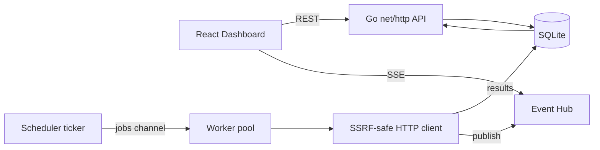

# PulseWatch

Real-time HTTP/HTTPS API monitoring dashboard.

Portfolio project demonstrating **Go concurrency**, a clean REST API, SQLite persistence, Server-Sent Events, and a polished **React + TypeScript** UI.

> Learning notes for Go (in Czech): [GO_LEARNING_GUIDE.md](./GO_LEARNING_GUIDE.md)

---

## Overview

PulseWatch lets you:

- Add public HTTP/HTTPS endpoints to monitor
- View live UP / DOWN status, latency, and HTTP status codes
- Enable / disable monitors and trigger manual checks
- Inspect response-time charts and check history
- Receive live updates over SSE (no page refresh)

Monitoring performs **real outbound HTTP requests** from a bounded Go worker pool.

---

## Technology stack

| Layer | Choice |
| --- | --- |
| Backend | Go 1.27, `net/http`, `database/sql`, `log/slog`, goroutines + channels |
| Database | SQLite via `modernc.org/sqlite` (pure Go, no CGO) |
| Realtime | Server-Sent Events |
| Frontend | React, TypeScript, Vite, Tailwind CSS, TanStack Query, Recharts |
| Ops | Docker multi-stage builds, Docker Compose |

---

## Architecture



### Backend packages

```
backend/
  cmd/server/          # process entrypoint, config, graceful shutdown
  internal/
    api/               # HTTP handlers, validation, middleware
    monitor/           # SSRF guards, checker, worker-pool engine
    storage/           # SQLite access + embedded migrations
    models/            # shared domain types
    events/            # non-blocking SSE fan-out hub
  migrations/          # human-readable SQL (also embedded under storage/)
```

---

## Quick start (local)

### Prerequisites

- Go 1.22+ (developed with 1.27)
- Node.js 20+
- Optional: Docker / Docker Compose

### 1. Backend

```bash
cd backend
go run ./cmd/server
```

API listens on `http://localhost:8080`.

### 2. Frontend

```bash
cd frontend
npm install
npm run dev
```

UI: `http://localhost:5173` (Vite proxies `/api` to the backend).

### Docker Compose

```bash
docker compose up --build
```

- UI: http://localhost:3000  
- API: http://localhost:8080  

---

## Environment variables

See [.env.example](./.env.example).

| Variable | Default | Description |
| --- | --- | --- |
| `PULSEWATCH_ADDR` | `:8080` | HTTP listen address |
| `PULSEWATCH_DB` | `./data/pulsewatch.db` | SQLite file path |
| `PULSEWATCH_WORKERS` | `5` | Concurrent check workers |
| `PULSEWATCH_HTTP_TIMEOUT_SEC` | `5` | Per-request HTTP timeout |
| `VITE_API_BASE` | _(empty)_ | Frontend API origin; empty = same-origin / Vite proxy |

---

## API overview

| Method | Path | Description |
| --- | --- | --- |
| `GET` | `/api/health` | Liveness |
| `GET` | `/api/monitors` | List monitors + latest status |
| `POST` | `/api/monitors` | Create monitor |
| `GET` | `/api/monitors/{id}` | Get one monitor |
| `PATCH` | `/api/monitors/{id}` | Partial update |
| `DELETE` | `/api/monitors/{id}` | Delete monitor |
| `POST` | `/api/monitors/{id}/check` | Run check immediately |
| `GET` | `/api/monitors/{id}/history` | Recent check results |
| `GET` | `/api/monitors/{id}/stats` | Per-monitor statistics |
| `GET` | `/api/stats` | Dashboard aggregates |
| `GET` | `/api/events` | SSE stream |

Example create:

```bash
curl -s -X POST http://localhost:8080/api/monitors \
  -H 'Content-Type: application/json' \
  -d '{"name":"Example","url":"https://example.com","interval_seconds":30}'
```

---

## Worker pool

1. A **scheduler** ticks every second and loads enabled monitors from SQLite.
2. Due monitors are pushed onto a **buffered jobs channel**.
3. A fixed number of **worker goroutines** (default 5) pull jobs and run HTTP checks.
4. An `inflight` map prevents the same monitor from being checked twice concurrently.
5. If the channel is full, the tick is skipped (back-pressure) instead of blocking the scheduler.
6. Results are persisted and published to the SSE hub.
7. On `SIGINT` / `SIGTERM`, `context` cancellation stops the scheduler; workers drain and exit.

Why Go? Lightweight goroutines + channels make a bounded concurrent poller straightforward without an external queue.

---

## Server-Sent Events

- Clients open `GET /api/events` (`text/event-stream`).
- The hub fans out JSON payloads on a **buffered channel per subscriber**.
- Slow clients are **dropped for that event** so monitoring workers never block on UI consumers.
- Heartbeat comments keep proxies from closing idle connections.
- The React hook patches TanStack Query caches for monitors / history / stats.

---

## Security (SSRF)

User-supplied URLs are dangerous because the server fetches them. PulseWatch applies layered SSRF controls:

1. Allow only `http` / `https`
2. Reject credentials in the URL
3. Reject localhost / metadata hostnames
4. Reject literal private / loopback / link-local / multicast / CGNAT / documentation IPs (IPv4 + IPv6)
5. Custom dialer: resolve DNS, filter non-public IPs, dial only approved addresses (**DNS rebinding defense**)
6. Redirects disabled (`CheckRedirect` → stop); 3xx still counts as UP without following
7. Response body drained with a hard size limit
8. Shared client with timeouts and connection limits; `HTTP_PROXY` ignored for checks

**Limitations:** this is defense-in-depth for a portfolio/demo, not a guarantee against every exotic SSRF technique (e.g. rare DNS edge cases, future special-use ranges, application-layer smuggling). Do not expose an unauthenticated instance to the public internet without additional controls.

---

## Testing

```bash
cd backend
go test ./...
go test -race ./...
go vet ./...

cd ../frontend
npm run build   # includes TypeScript check (tsc -b)
```

Tests use `httptest` and a test-only checker that skips production dial restrictions **without** changing production SSRF code paths.

---

## Known limitations

- No authentication / multi-tenancy
- SQLite single-writer model (fine for this scale)
- History capped at 500 results per monitor
- Only GET checks (no custom methods/headers/body)
- Redirect targets are not followed (by design)
- SSE is best-effort; dropped events require a later refetch/invalidation

---

## Potential future improvements

- Auth (API keys / OIDC)
- Custom headers, expected status codes, keyword assertions
- Alerting (email / Slack / webhooks)
- Multi-region checkers
- Postgres for multi-instance deployments
- OpenTelemetry metrics/traces

---

## License

MIT — feel free to use this project as an interview portfolio piece.
